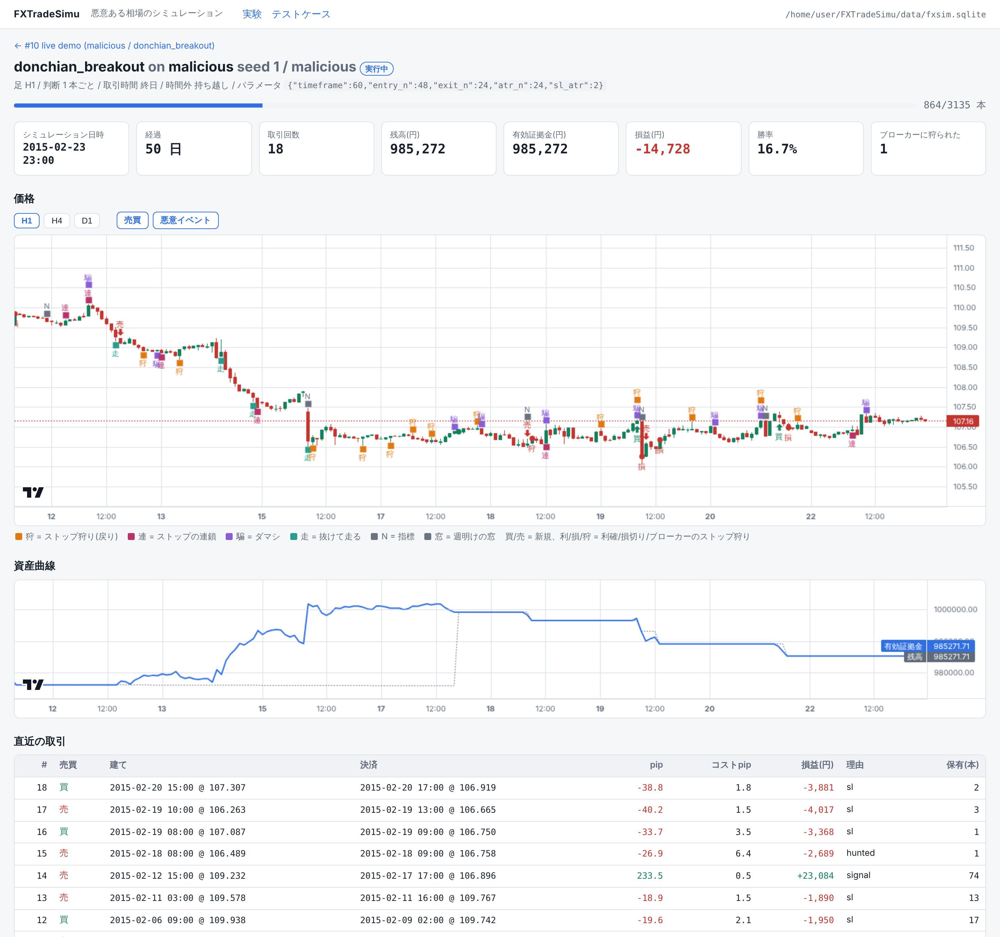
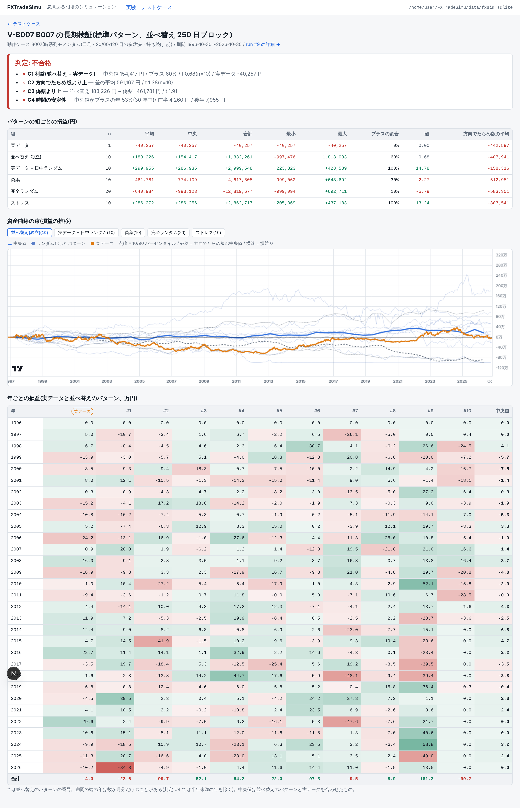
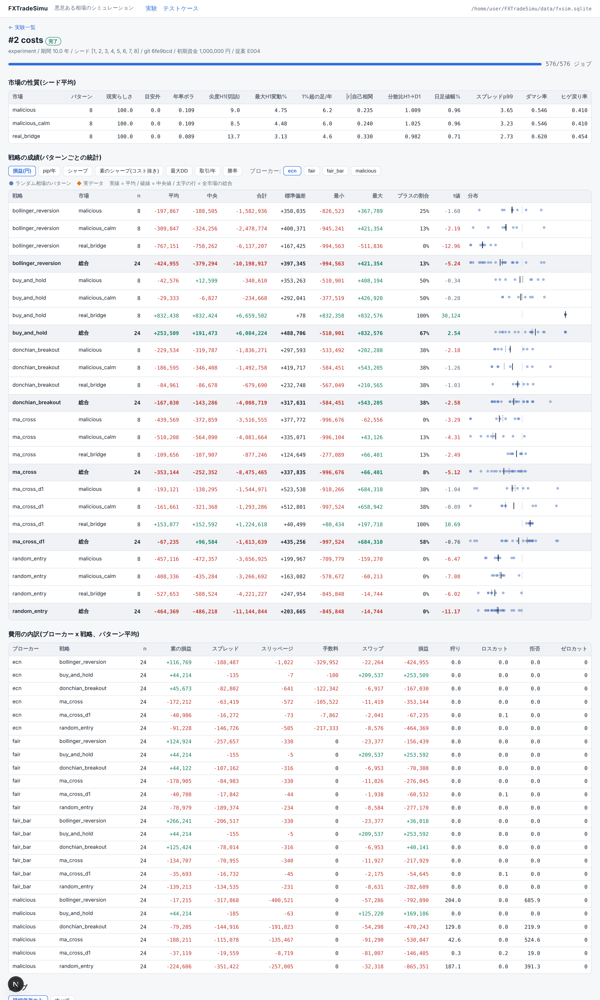
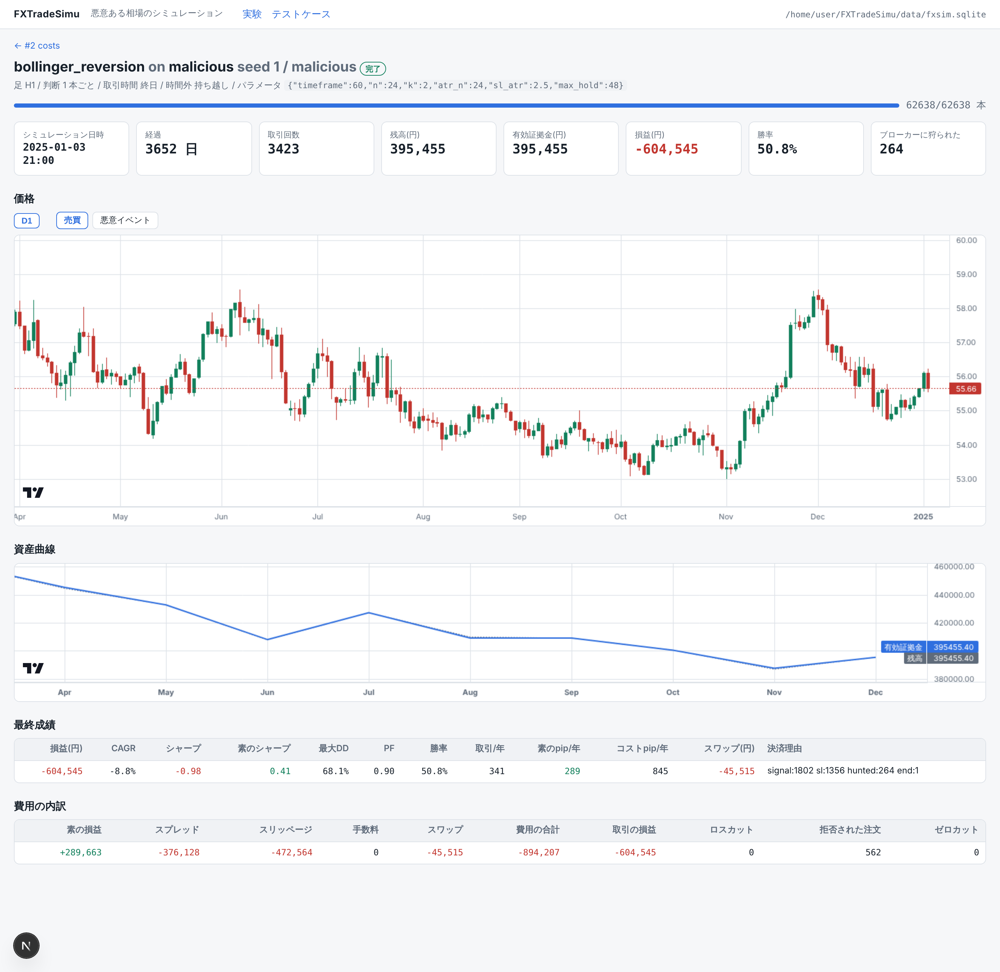
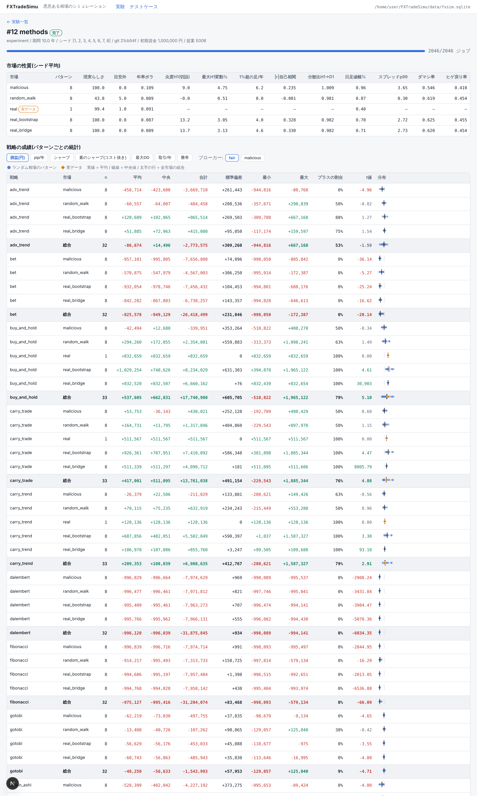

# FXTradeSimu

「悪意ある為替相場」を合成し、FX のトレード手法を長期間シミュレーションする。

- **市場モデル**: ランダムウォークから、実際の為替の統計的性質を持つ相場、さらに「群衆が一番痛がる方へ動く」悪意
  (ストップ狩り・ダマシ・群衆の逆突き)を持つ相場まで。部品を組み合わせて案を増やせる
- **実データ**: USD/JPY 日足(FRED)をそのまま再生するほか、実際の相場の範囲でランダムに変動する相場
  (実データの日足を通り、足の中だけランダム)や、実データのリターンを並べ替えた相場を何本でも作れる
- **異常な値動きと薄商い**: フラッシュクラッシュ・為替介入・ショック、年末年始などの薄商い(スプレッドが広がる)
- **取引の費用**: スプレッド(ブローカーの上乗せ・下限)、手数料(ECN)、政策金利の差から毎日計算するスワップ、
  足の中の経路で約定する損切り(急変では大きく滑る)、ロスカット。費用は内訳(スプレッド・スリッページ・手数料・スワップ)で記録
- **ブローカーの悪意**: 不利な方向だけのスリッページ、有利な窓を渡さない約定、あなたの逆指値を狙うストップ狩り、
  スワップとスプレッドの上乗せ、ラストルック(有利な注文の拒否)、ゼロカットなし
- **よくある投資手法**: デイトレード(ロンドンブレイク・五十日・ピボット・スキャルピング)、テクニカル(RSI・ストキャス・MACD・
  一目・パラボリック・ADX・パーフェクトオーダー・平均足)、中長期(タートル・キャリー・長期の平均回帰・ボラ・ターゲット)、
  新しめの手法(相場の性格で切り替え・オンライン学習・カルマンフィルタ)、ギャンブルの賭け方(マーチンゲール・パーリー・
  ダランベール・フィボナッチ・ラブシェール・オスカーズ・グラインド・ケリー・ナンピン)。一覧は `docs/proposals/strategies/`
- **動作ケース / テストケース**: 「どう取引するか」と「どの相場パターンで何年試すか」を YAML で書き、機械的に実行・記録
- **ひとつのモデルの長期検証**: 実データ・並べ替えた別の歴史・偽薬・完全ランダムの多数のパターンで、
  「方向だけでたらめ版」と対にして回し、長期的に利益が出るかを合格 / 条件付き / 不合格で判定(`fxsim verify`)
- **結果は SQLite**(`data/fxsim.sqlite`、コミットしている)。シミュレーション中も逐次書き込む
- **画面**(`web/`、Next.js、ローカル専用): 実行中のシミュレーションをリアルタイムに表示



## 使い方

```bash
pip install -r requirements.txt
python -m fxsim list                                  # 市場モデル・戦略・ブローカー
python -m fxsim run configs/quick.yaml                # 動作確認(数十秒)
python -m fxsim run configs/long_run_baseline.yaml    # 10 年の長期実験(4 コアで約 2 分)
python -m fxsim cases run --all                       # テストケースを全部実行
python -m fxsim verify B007 --years 30 --seeds 1-10 --block-days 250   # ひとつのモデルの長期検証
python -m fxsim report --patterns                     # 最新の実験の結果を Markdown で
python -m fxsim eval-strategy ma_cross --params '{"timeframe": 1440}' --null --patterns
python -m fxsim eval-market malicious                 # 市場の案の評価
python -m fxsim ablate malicious                      # どの悪意が効いているか
python -m pytest -q
ruff check fxsim tests
```

画面(ローカル):

```bash
cd web && npm install && npm run build && npm start    # http://localhost:3000
```

別の端末でシミュレーションを流すと、画面がリアルタイムに更新される:

```bash
python -m fxsim demo --years 0.5 --delay-ms 200
```

## ドキュメント

- `CLAUDE.md` — 案を出し、評価し、磨き続けるための手順(Claude 向け)
- `docs/ARCHITECTURE.md` — 構成
- `docs/MARKET_MALICE.md` — 市場の悪意の一覧と測り方
- `docs/CASES.md` — 動作ケースとテストケースの書き方
- `docs/proposals/` — 案ごとの仮説・結果・判定・次の一手(E001 が最初の長期実験)
- `data/real/README.md` — 実データの出典

## 画面

| モデルの長期検証(判定・資産曲線の束・年ごと) | 実験の結果(パターンごとの統計・費用の内訳) |
|---|---|
|  |  |

| 1 本のバックテスト(価格・資産曲線・最終成績・費用の内訳) | よくある手法の比較(E006) |
|---|---|
|  |  |

## 履歴

- 2021/02/18 ランダムウォークのチャートを PDF で出力する最初の版(`RandomWorkMarket.py`)
- 2026/11 `fxsim` パッケージとして作り直し。可視化(matplotlib / PDF)は削除し、表示は Next.js に移した
